# Barbearia: sistema de agendamento com duas áreas (Cliente e Empresa)


Sistema de agendamento para barbearias, feito com **FastAPI** e **SQLAlchemy** (SQLite em desenvolvimento, PostgreSQL em produção). São duas aplicações web independentes, em **portas diferentes**, que compartilham o mesmo banco:

| Área | Porta | Quem usa | O que faz |
|------|-------|----------|-----------|
| **Cliente** | 8000 | Quem quer cortar o cabelo | Informa nome, e-mail e telefone, escolhe serviço e dia, vê os barbeiros com horários livres (ou "qualquer barbeiro"), marca, recebe confirmação e lembrete por e-mail, remarca ou cancela com um código, baixa o evento `.ics` e acessa "meus agendamentos" por um link enviado ao e-mail |
| **Empresa** | 8001 | A barbearia | Login e senha com papéis **dono** e **barbeiro**. Agenda do dia por barbeiro, agendamentos com status (agendado, concluído, faltou, cancelado), cadastros com busca e paginação, disponibilidade semanal, folgas e feriados, vendas de produtos com baixa de estoque, relatório de ocupação e receita, exportação CSV e usuários |

Projeto de estudo, criado para portfólio, e organizado como um produto: proteção contra abuso na área pública, notificações reais por SMTP, auditoria de cancelamentos, LGPD (anonimização de dados) e empacotamento com Docker.

## Telas

### Área do Cliente

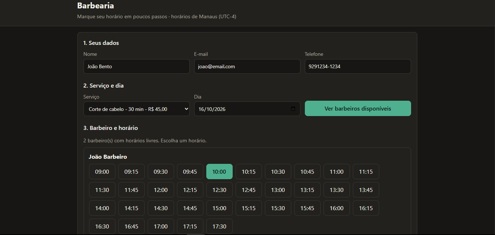

*O cliente informa seus dados, escolhe o serviço e o dia e vê só os barbeiros com horário livre.*

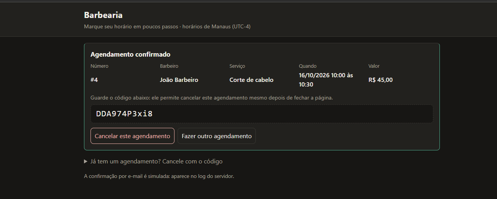

*Confirmação com número, valor e o código que permite cancelar ou remarcar depois.*

No celular (layout responsivo):

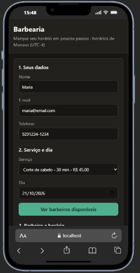 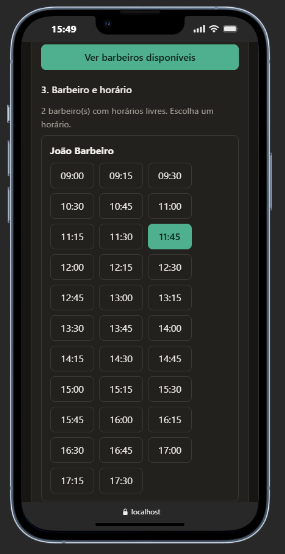

### Área da Empresa

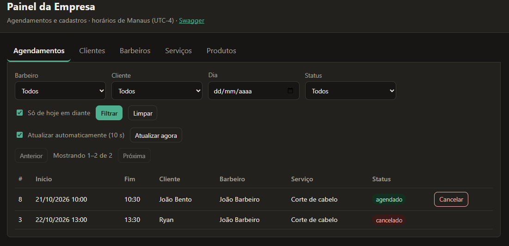

*Agendamentos com filtros, status e paginação.*

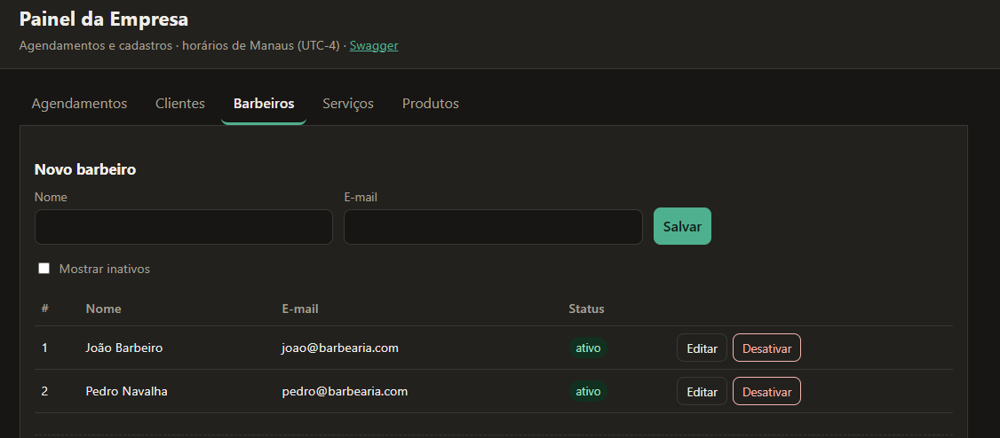

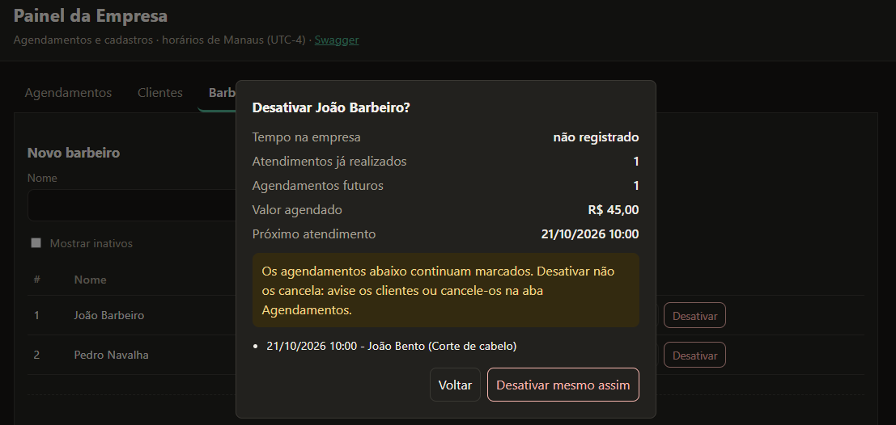

*Antes de desativar um barbeiro, o sistema mostra quantos agendamentos futuros serão afetados.*

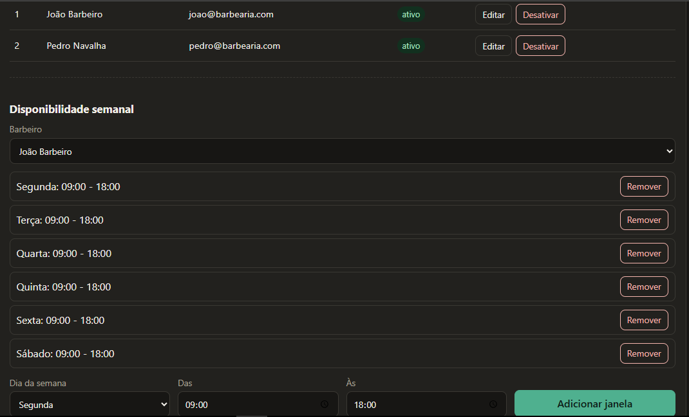

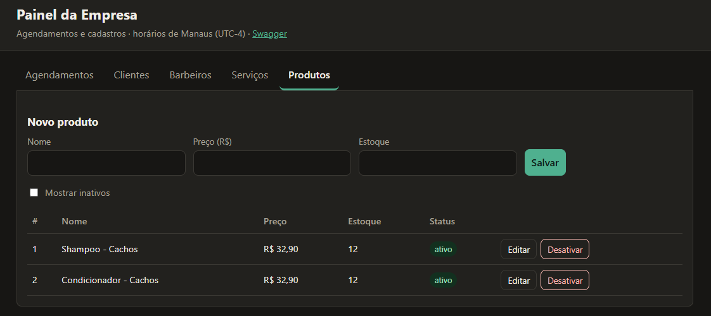 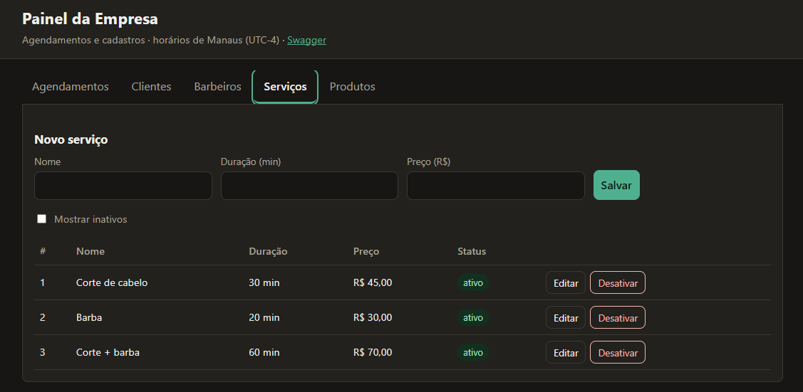

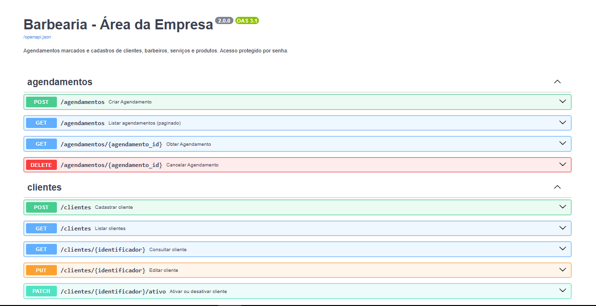

*As capturas são da versão 2; a versão 3 acrescentou login, agenda do dia, bloqueios, vendas, relatórios e usuários.*

## O que este projeto demonstra

- **API REST em camadas** (routers → services → repositories → models), com regras de negócio sem dependência de HTTP.
- **Sem conflito de horário, mesmo sob concorrência:** a checagem e a gravação acontecem na mesma transação de escrita (`BEGIN IMMEDIATE` no SQLite, `SELECT ... FOR UPDATE` no PostgreSQL). Leituras não bloqueiam ninguém. Há um teste de concorrência real.
- **Ciclo de vida completo do agendamento:** `agendado` → `concluido` ou `nao_compareceu` (só depois do horário) ou `cancelado` (só antes), com quem cancelou, quando e por quê. Nada reescreve o histórico.
- **Autenticação de verdade:** usuários no banco com senha em `scrypt`, sessão por cookie assinado (HMAC) ou HTTP Basic para API e Swagger. Papel **barbeiro** só enxerga a própria agenda.
- **Proteção da área pública:** limite de agendamentos ativos por e-mail e por telefone, limite de requisições por IP, mensagens que não revelam cadastros.
- **Notificações:** confirmação, cancelamento, lembrete (thread em segundo plano) e link mágico, por SMTP ou no log em desenvolvimento, sempre com o e-mail mascarado no log.
- **Agenda rica:** janelas que se encostam valem como uma só, bloqueios por data (folga, feriado, almoço), intervalo entre atendimentos, remarcação e "qualquer barbeiro".
- **LGPD:** o cliente apaga os próprios dados pelo link mágico e a empresa pode anonimizar um cadastro; o histórico de agendamentos permanece sem dados pessoais.
- **Front-end em HTML, CSS e JavaScript puros**, sem Node nem etapa de build, com tema claro/escuro e layout responsivo.
- **Testes automatizados:** 356 testes de API e serviços (cobertura mínima de 95%, hoje 98%) e 20 testes de navegador com Playwright. Lint e formatação com `ruff`.
- **Dinheiro com `Decimal`**, nunca `float`: preços trafegam como texto (`"45.00"`).
- **Fuso configurável** (`TIMEZONE`, padrão Manaus): o navegador lê o fuso do servidor em `GET /configuracao`.

## Stack

Python 3.10+ (testado com 3.13) · FastAPI · SQLAlchemy 2 (SQLite ou PostgreSQL via psycopg) · Pydantic v2 · pytest · Playwright · ruff · Docker · HTML/CSS/JavaScript puros

## Como rodar

**Requisito:** Python 3.10 ou superior. Se o `python3` da sua máquina for mais antigo, aponte outro: `PYTHON=python3.13 make install`.

### Com `make`

```bash
git clone https://github.com/debug-RyanLopes/sistema-de-agendamento.git
cd sistema-de-agendamento
cp .env.example .env   # opcional: o Makefile lê o .env

make install   # cria o .venv e instala as dependências
make seed      # dados de exemplo
make run       # sobe as DUAS áreas (Ctrl+C encerra as duas)
```

### Sem `make`

```bash
python3 -m venv .venv && source .venv/bin/activate     # Windows: .venv\Scripts\activate
pip install -r requirements-dev.txt
python -m scripts.seed
export ADMIN_PASSWORD=admin123                           # Windows: $env:ADMIN_PASSWORD = "admin123"
python -m scripts.dev
```

### Com Docker

```bash
docker compose up --build                       # app + PostgreSQL
docker compose run --rm app python -m scripts.seed
docker compose --profile producao up -d         # inclui o proxy Caddy com HTTPS (ajuste deploy/Caddyfile)
```

### Acessos

| Área | URL | Credenciais |
|------|-----|-------------|
| Cliente | http://127.0.0.1:8000/ | nenhuma |
| Empresa | http://127.0.0.1:8001/ | login `admin`, senha `ADMIN_PASSWORD` (padrão do `make`: `admin123`) |
| Swagger | `/docs` em cada porta | a da empresa pede login (cookie da página ou Basic) |

Na primeira subida da área da empresa o usuário `admin` (papel dono) é criado com a `ADMIN_PASSWORD`. Depois disso a senha vale a que está no banco: troque-a na aba **Usuários**.

## Roteiro de avaliação (cerca de 5 minutos)

Com `make seed` e `make run` já executados:

1. Abra a **área do Cliente** (porta 8000) e a **área da Empresa** (porta 8001) em duas abas. Entre na empresa com `admin` / `admin123`.
2. No **Cliente**, preencha seus dados, escolha serviço e dia (o seed abre segunda a sábado, 9h às 18h) e clique em *Ver barbeiros disponíveis*. Com dois barbeiros livres aparece também o cartão **Qualquer barbeiro**.
3. Escolha um horário e confirme. Anote o **número** e o **código**. Experimente *Remarcar* e *Adicionar à minha agenda (.ics)*.
4. Na **Empresa**, aba *Agendamentos*, o agendamento aparece (a lista atualiza a cada 10 s). A aba *Agenda do dia* mostra a coluna de cada barbeiro, com bloqueios.
5. Tente marcar o mesmo horário de novo: ele já não aparece. Marque 3 horários com o mesmo e-mail e tente o quarto: a área pública recusa.
6. Na **Empresa**, aba *Bloqueios*, cadastre uma folga para hoje: o barbeiro some da área do cliente naquele dia.
7. Em *Barbeiros*, desative um barbeiro: a confirmação mostra o impacto. Em *Usuários*, crie um usuário com papel barbeiro e entre com ele em outra janela anônima: ele vê só a própria agenda.
8. Em *Vendas*, registre uma venda e veja o estoque baixar em *Produtos*. Em *Relatórios*, veja ocupação e receita do mês. Em *Agendamentos*, use *Exportar CSV*.
9. No **Cliente**, abra "Já tem um agendamento?" e peça o link por e-mail. O link aparece no terminal do `make run` (e-mail simulado); ele abre "Meus agendamentos", onde dá para cancelar e apagar os próprios dados.
10. Observe o terminal: confirmações, cancelamentos e lembretes aparecem no log com o e-mail mascarado.

Rodar os testes:

```bash
make test     # API e serviços (rápidos, sem navegador)
make cov      # com cobertura (mínimo de 95% definido no pyproject)
make lint     # ruff (lint e formatação)
make e2e      # 20 testes de navegador (precisa do Google Chrome ou `playwright install chromium`)
```

## Área do Cliente

| Método | Rota | Descrição |
|--------|------|-----------|
| GET | `/servicos` | Serviços ativos |
| GET | `/disponibilidade?data=AAAA-MM-DD&servico_id=` | Barbeiros ativos com horários livres no dia |
| POST | `/agendamentos` | Marcar (nome, e-mail, telefone, serviço, início; `barbeiro_id` opcional = qualquer barbeiro) |
| POST | `/agendamentos/{id}/cancelar` | Cancelar com o código |
| POST | `/agendamentos/{id}/reagendar` | Remarcar com o código |
| GET | `/agendamentos/{id}/ics?codigo=` | Evento de calendário |
| POST | `/meus-agendamentos/solicitar` | Pede o link mágico por e-mail (responde 202 sempre) |
| GET | `/meus-agendamentos?token=` | Agendamentos futuros do e-mail do link |
| POST | `/meus-dados/exclusao?token=` | Anonimiza o próprio cadastro (LGPD) |
| GET | `/configuracao`, `/saude` | Fuso, grade de horários e verificação de saúde |

**Datas:** o cliente só enxerga de hoje até o último dia do mês corrente, no navegador e no servidor (422). Horários começam em múltiplos de `SLOT_MINUTES`.

**Limites:** no máximo `MAX_AGENDAMENTOS_ATIVOS_POR_CLIENTE` horários futuros por e-mail ou telefone (padrão 3) e `LIMITE_REQUISICOES_POR_MINUTO` escritas por IP (padrão 60, 429 ao exceder). Cliente inativo recebe uma mensagem genérica.

O cliente é identificado pelo e-mail: se já existe, o cadastro é reaproveitado sem sobrescrever nome e telefone. Código errado e agendamento inexistente recebem a mesma resposta (404).

## Área da Empresa

Uma página com abas, após o login em `/entrar`:

- **Agendamentos:** filtros (barbeiro, cliente com busca, dia, status), só de hoje em diante por padrão, paginação, exportar CSV. Ações por linha: *Remarcar* e *Cancelar* (com motivo) para horários futuros; *Concluído* e *Faltou* para horários passados.
- **Agenda do dia:** uma coluna por barbeiro com os atendimentos e os bloqueios.
- **Clientes, Barbeiros, Serviços e Produtos:** criar, editar e ativar/desativar (sem excluir), busca e paginação. Clientes têm *Apagar dados* (LGPD). Desativar barbeiro mostra o impacto nos agendamentos futuros.
- **Barbeiros → Disponibilidade semanal:** janelas por dia da semana; janelas que se encostam valem como uma só.
- **Bloqueios:** folgas, feriados (toda a barbearia) e bloqueios por hora (almoço), por data.
- **Vendas:** registra venda de produtos e baixa o estoque na mesma transação.
- **Relatórios:** por período, ocupação (minutos ocupados / disponíveis), agendados, concluídos, faltas, cancelados, receita de serviços e de produtos.
- **Usuários:** cria dono ou barbeiro (vinculado a um cadastro de barbeiro), troca senha, ativa/desativa.

Usuário com papel **barbeiro** vê e mexe só na própria agenda (lista, status, cancelamento, remarcação, CSV) e lê os cadastros; o resto responde 403.

### Rotas principais da empresa

`/auth/login`, `/auth/logout`, `/auth/eu` · `/usuarios` · `/agendamentos` (GET paginado com `desde`/`ate`, POST, GET/{id}, DELETE/{id}?motivo=, PATCH/{id}/status, POST/{id}/reagendar) · `/clientes`, `/barbeiros`, `/servicos`, `/produtos` (GET com `busca`, `limite`, `deslocamento`, `ordem`, total em `X-Total-Count`; POST, PUT, PATCH .../ativo) · `/clientes/{id}/anonimizar` · `/barbeiros/{id}/disponibilidades`, `/barbeiros/{id}/horarios-livres`, `/barbeiros/{id}/impacto-desativacao` · `/bloqueios` · `/vendas` · `/relatorios/resumo`, `/relatorios/agendamentos.csv` · `/configuracao`, `/saude`. Tudo documentado no Swagger da porta 8001.

### Códigos de resposta da API

| Código | Quando |
|--------|--------|
| 201 | Cadastro, agendamento, venda ou usuário criado |
| 202 | Pedido de link mágico aceito |
| 401 | Área da empresa sem login ou com senha errada |
| 403 | Papel sem permissão (barbeiro mexendo em cadastros ou na agenda de outro) |
| 404 | Recurso inexistente, código de cancelamento inválido ou link expirado |
| 409 | Conflito de horário, e-mail repetido, status incompatível (cancelar o concluído, concluir o futuro), estoque insuficiente |
| 422 | Dados inválidos, recurso inativo, fora da disponibilidade, no passado, fora da janela do mês, limite de agendamentos por cliente |
| 429 | Muitas requisições do mesmo IP na área pública |

## Configuração

Veja `.env.example`. Principais variáveis:

| Variável | Padrão | Descrição |
|----------|--------|-----------|
| `ADMIN_PASSWORD` | (obrigatória) | Senha inicial do usuário `admin`. Sem ela a área da empresa **não sobe** |
| `DATABASE_URL` | `sqlite:///./barbearia.db` | `postgresql+psycopg://...` em produção |
| `SECRET_KEY` | aleatória por processo | Assina cookies de sessão e links mágicos; defina em produção |
| `SLOT_MINUTES` / `INTERVALO_MINUTOS` | `15` / `0` | Grade de horários e intervalo obrigatório entre atendimentos |
| `TIMEZONE` | `America/Manaus` | Fuso de toda a aplicação, inclusive no navegador |
| `MAX_AGENDAMENTOS_ATIVOS_POR_CLIENTE` | `3` | 0 desliga |
| `LIMITE_REQUISICOES_POR_MINUTO` | `60` | Escritas por IP na área pública; 0 desliga |
| `SMTP_HOST`, `SMTP_PORT`, `SMTP_USUARIO`, `SMTP_SENHA`, `SMTP_REMETENTE`, `SMTP_TLS` | (vazio) | Sem `SMTP_HOST` os e-mails vão para o log |
| `LEMBRETE_HORAS` | `24` | Antecedência do lembrete; 0 desliga |
| `URL_PUBLICA` | `http://127.0.0.1:8000` | Base dos links enviados por e-mail |
| `LOG_LEVEL`, `LOG_JSON` | `INFO`, `0` | Log em texto ou uma linha JSON por evento |
| `HOST`, `PORTA_CLIENTE`, `PORTA_ADMIN` | `127.0.0.1`, `8000`, `8001` | Endereço e portas do `make run` |

## Arquitetura

```text
app/main_cliente.py   app/main_admin.py      duas aplicações FastAPI (fábricas criar_app)
app/aplicacao.py                              fábrica comum: erros, banco, estáticos, inicializadores
app/routers/          rotas HTTP finas        publico · agendamentos · cadastros · disponibilidades (+bloqueios)
                                              gestao_barbeiros · vendas · relatorios · auth (+usuarios) · sistema
app/services/         regras de negócio       agendamento · disponibilidade · cadastro · barbeiro · venda
                                              relatorio · auth · notificacao · lembrete
app/repositories/     acesso a dados          agendamentos · cadastros · disponibilidades · bloqueios
app/seguranca.py      autenticação (cookie ou Basic)      app/limites.py   limite de requisições
app/database.py       motor, transações de escrita, migração leve
app/static/           cliente/ · admin/ · comum/
scripts/              dev.py (sobe as duas áreas) · seed.py
deploy/               Caddyfile (HTTPS)       Dockerfile · docker-compose.yml
tests/                serviços, APIs, segurança, concorrência, migração e e2e/
```

Decisões de projeto:

- Serviços levantam exceções de domínio; uma tabela única as converte em 401/403/404/409/422.
- Quem grava chama `iniciar_escrita(session)` antes da primeira consulta: no SQLite isso vira `BEGIN IMMEDIATE`; leituras ficam em `BEGIN DEFERRED` e o banco em modo WAL. No PostgreSQL a linha do barbeiro é travada com `SELECT ... FOR UPDATE`.
- Notificações rodam em `BackgroundTasks` depois do commit; os lembretes rodam numa thread da área da empresa que marca `lembrete_enviado_em` antes de enviar, para nunca repetir.
- A autenticação é um middleware ASGI que resolve o usuário no banco; as rotas recebem `UsuarioDep` e `SomenteDono`.
- Relógio, notificador e chave de assinatura são injetados (`Depends`), o que deixa os testes determinísticos.
- `ativo` substitui a exclusão; a anonimização substitui o apagamento de clientes. A migração leve acrescenta colunas e índices a bancos SQLite antigos sem perder dados.

## Limitações conhecidas

- A confirmação por e-mail não é exigida antes de reservar o horário (double opt-in). Com SMTP configurado, isso seria o próximo passo contra agendamentos falsos.
- WhatsApp não está integrado; a interface `Notificador` deixa isso a um adaptador de distância.
- O limite de requisições é por processo; com várias réplicas use o proxy ou um Redis.
- A migração leve cobre só o SQLite. Em PostgreSQL o esquema nasce completo pelo `create_all`; mudanças futuras de esquema pedem Alembic.
- Um serviço por agendamento; sem múltiplas unidades (multi-tenant).
- Os testes de navegador rodam no Chrome/Chromium.
- As capturas de tela ainda são da versão anterior.

## Como o projeto foi desenvolvido

A primeira versão (API única) seguiu um fluxo de especificação em fases (brainstorm, requisitos, design, construção e entrega); os documentos estão em `.claude/sdd/archive/`. A separação em duas áreas veio depois. A versão 3 partiu de uma avaliação completa do repositório (falhas, ajustes e funcionalidades faltantes) implementada em uma única rodada.

## Licença

[MIT](LICENSE): você pode usar, copiar e modificar o código, mantendo o aviso de copyright.
